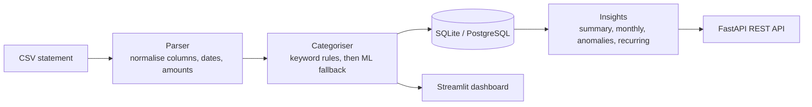

# UPI Statement Analyzer

[](https://github.com/mohankumarbm04/upi-statement-analyzer/actions/workflows/ci.yml)


Upload a bank or UPI statement (CSV) and get automatic spending categories, monthly trends, subscription detection and alerts for unusual transactions, through a **REST API** and an **interactive dashboard**.

Banks give you a wall of narrations like `UPI/DR/412345678901/SWIGGY/okaxis/Payment`. This project turns that into answers: *Where does my money go? What am I paying for every month? Was I charged twice?*

<!-- Add a screenshot of the dashboard here:  -->

## Features

- **Flexible CSV parser**: handles separate debit/credit columns, a single signed amount, a Dr/Cr column, preamble lines above the header, `₹`/`Rs.` prefixes, thousands separators and day-first dates.
- **Merchant extraction** from UPI narrations (`UPI/DR/...`, `UPI-NAME-handle@bank-...`), NEFT/IMPS/ATM entries and masked card numbers.
- **Two-stage categorisation**: keyword rules first, then a character n-gram ML model for unseen merchants and typos (`Swigy` → Food & Dining). Uncertain guesses fall back to `Others` rather than being wrong with confidence.
- **Subscription detection**: finds payments that recur monthly at a steady amount (Netflix, rent, SIPs, gym).
- **Anomaly detection**: flags unusually large transactions within a category and possible duplicate charges.
- **REST API** (FastAPI + SQLAlchemy) with auto-generated Swagger docs, and the ability to correct a category.
- **Streamlit dashboard** with KPIs, monthly income vs spend, category and merchant rankings, searchable transactions and CSV export.
- Tested (75 tests, 97% coverage), linted, containerised, CI on Python 3.11-3.13.

## How it works



### Categorisation

1. **Rules**: 130+ keywords across 12 categories, matched against the whole narration. Short keywords (`ola`, `sip`, `atm`) match whole words only, so `coolant` never becomes a cab ride. Category order encodes priority: `Swiggy Instamart` is Groceries, `Amazon Prime` is Entertainment, not Food/Shopping.
2. **ML fallback**: TF-IDF on character n-grams plus logistic regression, trained on merchant names. It generalises to typos and near-matches.
3. **Confidence threshold**: predictions below 0.6 become `Others`. The threshold was picked empirically: misspelled merchants score about 0.7-0.9, while personal names (UPI transfers to friends) peak around 0.5. At the original 0.5, "Ankit Verma" was confidently filed under Groceries, and a regression test now guards that.

**Limitations (honest ones):** person-to-person UPI transfers land in `Others` because a bank narration doesn't say *why* you paid someone. The model is trained on a small hand-written merchant list, not on real labelled data. Correct any category with `PATCH /transactions/{id}`.

### Anomaly detection

- **Outliers**: within each category, a transaction is flagged when its *modified z-score* exceeds 3.5 (and it is ≥ ₹500). It uses the median and MAD instead of mean and standard deviation, so a single ₹48,999 purchase can't hide itself by inflating the average. Categories with fewer than 5 transactions are not judged.
- **Duplicates**: same merchant, same amount, same day (≥ ₹200).

On the bundled sample data this finds exactly the three planted problems:

```
2026-07-18 Croma   48999.0 | Unusually high for Shopping: ₹48,999 vs typical ₹1,936
2026-09-21 Uber     4250.0 | Unusually high for Transport: ₹4,250 vs typical ₹255
2026-08-09 Swiggy    749.0 | Possible duplicate charge (same merchant, amount and day)
```

## Quick start

```bash
git clone https://github.com/mohankumarbm04/upi-statement-analyzer.git
cd upi-statement-analyzer
python -m venv .venv && source .venv/bin/activate   # Windows: .venv\Scripts\activate
pip install -r requirements.txt
```

**Dashboard** (processes files in memory; nothing is stored):

```bash
streamlit run dashboard.py
```

**API** (stores statements in SQLite; interactive docs at http://localhost:8000/docs):

```bash
uvicorn app.main:app --reload
curl -F "file=@sample_data/sample_statement.csv" http://localhost:8000/statements
curl http://localhost:8000/statements/1/anomalies
```

**Docker**:

```bash
docker compose up --build   # API on :8000, dashboard on :8501
```

The database is configured with the `DATABASE_URL` environment variable (default: a local SQLite file). The models are plain SQLAlchemy, so another database such as PostgreSQL is a configuration change plus its driver, but only SQLite has been tested so far.

## API

| Method | Endpoint | Description |
|---|---|---|
| `POST` | `/statements` | Upload a CSV (max 5 MB); returns the statement and its summary |
| `GET` | `/statements` | List uploaded statements |
| `DELETE` | `/statements/{id}` | Delete a statement and its transactions |
| `GET` | `/statements/{id}/transactions` | Filter by `category`, `type`, search `q`; paginate with `limit`/`offset` |
| `PATCH` | `/transactions/{id}` | Correct a transaction's category |
| `GET` | `/statements/{id}/summary` | Spend, income, savings rate, average daily spend, largest expense |
| `GET` | `/statements/{id}/monthly` | Income / spend / net per month |
| `GET` | `/statements/{id}/categories` | Spend per category with share of total |
| `GET` | `/statements/{id}/merchants` | Top merchants (`?n=10`) |
| `GET` | `/statements/{id}/recurring` | Detected subscriptions and recurring payments |
| `GET` | `/statements/{id}/anomalies` | Unusual transactions with the reason each was flagged |

## Supported CSV formats

The header row is detected automatically (up to 30 lines of preamble are skipped). Recognised column names include:

| Meaning | Examples |
|---|---|
| Date | `Date`, `Txn Date`, `Transaction Date`, `Value Date` |
| Description | `Narration`, `Description`, `Particulars`, `Remarks` |
| Money out / in | `Withdrawal Amt.` + `Deposit Amt.`, `Debit` + `Credit`, or one `Amount` column (negative = debit, or with a `Dr/Cr` column) |
| Balance (optional) | `Closing Balance`, `Balance` |

PDF statements are not supported yet. Most banks offer a CSV/Excel export in net banking.

## Project structure

```
app/
  parser.py       # CSV -> clean DataFrame
  categorizer.py  # merchant extraction, rules + ML fallback
  insights.py     # summary, monthly, anomalies, recurring (pure pandas, no I/O)
  database.py     # SQLAlchemy models and session handling
  service.py      # glue between the analysis code and the database
  schemas.py      # Pydantic request/response models
  main.py         # FastAPI routes
  charts.py       # Plotly figures for the dashboard
dashboard.py      # Streamlit app
sample_data/      # synthetic statement + the script that generates it
tests/            # pytest suite (parser, categoriser, insights, API, charts)
```

The analysis code in `parser.py`, `categorizer.py` and `insights.py` has no web or database dependencies, so the API and the dashboard share exactly the same logic.

## Design notes

- Chart form follows the data's job: grouped columns for two series over time, single-colour horizontal bars for rankings (never pie charts), values labelled at the bar ends.
- The two-series palette (blue and orange) was run through a colour-vision-deficiency separation and contrast check in both light and dark mode, and every chart has a table view for accessibility.
- Amounts use Indian digit grouping (₹1,32,000).

## Development

```bash
pip install -r requirements-dev.txt
pytest --cov=app      # 75 tests
ruff check .
python sample_data/generate_sample.py   # regenerate the synthetic statement
```

CI runs lint and tests on Python 3.11, 3.12 and 3.13 for every push and pull request.

## Privacy

The sample statement is entirely synthetic. The dashboard processes uploads in memory only. If you use the API with your own statements, the data is stored in the local database file (`*.db` is git-ignored). Never commit real bank statements to a public repository.

## Roadmap

- Learn from corrections: retrain the categoriser from categories users have fixed
- PDF statement import
- Authentication and multi-user support
- Budgets and monthly spending alerts
